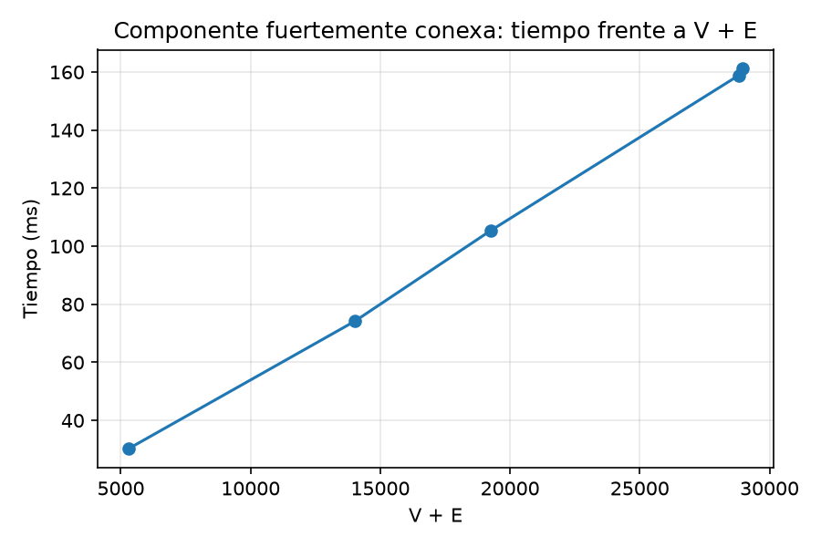
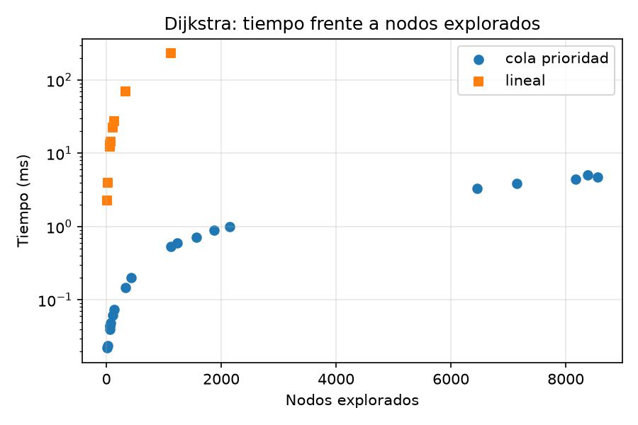
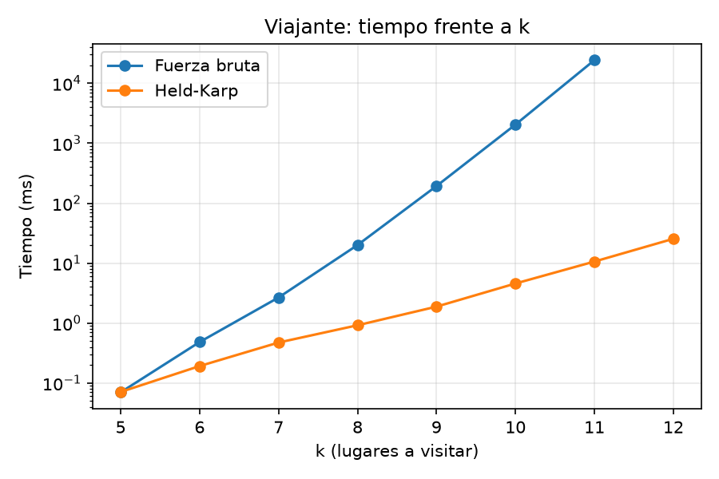
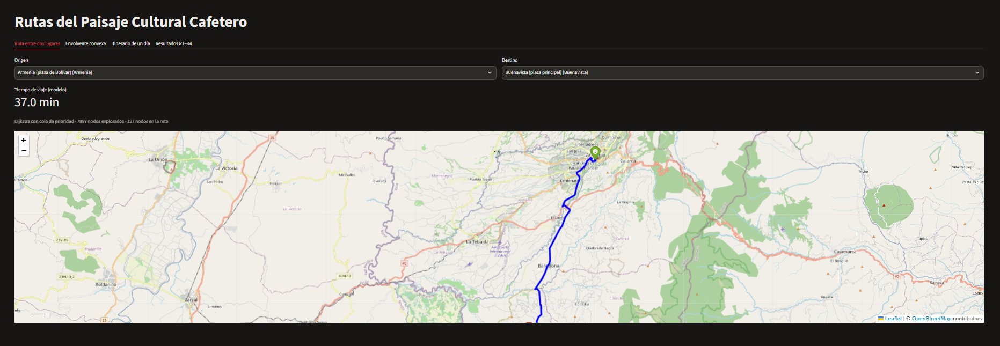
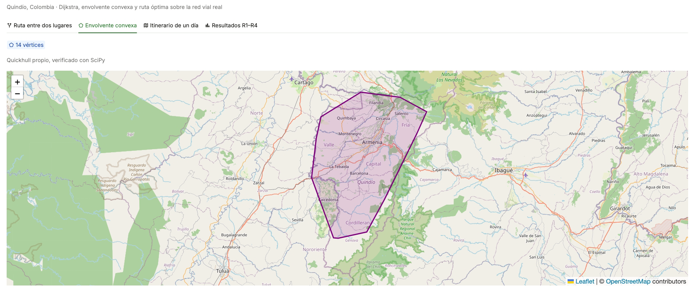
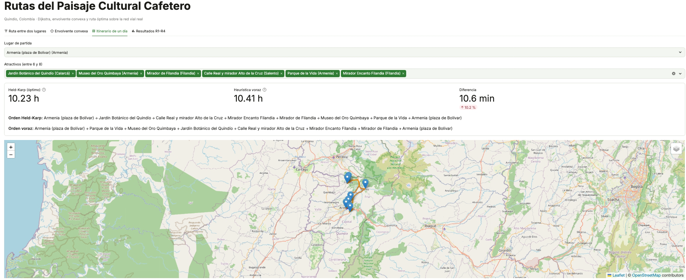

# Rutas del Paisaje Cultural Cafetero: documento técnico

Helen Xiomara Giraldo Libreros· Valentina Porras Salazar · Maryam Hernández Giraldo
Análisis de Algoritmos, 2026-2

> **Cómo usar esta plantilla.** La teoría (complejidades, recurrencias y argumentos de correctitud) ya está escrita. Lo que está entre corchetes **[LLENAR: …]** se completa con los números de `resultados/tablas.md` después de correr los scripts. Antes de entregar, cada una reescribe sus secciones con sus propias palabras.

**Máquina de las mediciones:** portátil Lenovo con procesador Intel Core i5-13450HX de 13.ª generación, 16 hilos, 31,7 GB de RAM, Windows 11 y Python 3.14.6. Todas las mediciones se hicieron en esa misma máquina.
**Fecha de descarga de la red:** 7 de noviembre de 2026. Versión de OSMnx: 2.1.1.

---

## 1. Arquitectura de la solución

```
 OpenStreetMap ──► r1_red.py ──► datos/componente.graphml ──┬──► r2_caminos.py ──► resultados/matriz_tiempos.csv ──► r4_ruta.py
 catalogo.csv  ──►   (R1)    ──► datos/lugares_nodos.csv ───┤        (R2)                                            (R4)
                                                            └──► r3_envolvente.py ──► r3_envolvente_red.json
                                                                       (R3)
 resultados/*.csv ──► graficas.py ──► graficas/*.png, resultados/tablas.md
 componente + lugares + matriz + envolvente ──► app.py (R5, Streamlit + Folium)
```

- `config.py` reúne las rutas, la semilla (2026), el número de repeticiones (5) y el límite de tiempo (5 min).
- `medicion.py` aplica el protocolo de la sección 6 del enunciado: mediana de 5 ejecuciones medidas con `time.perf_counter_ns`.
- `grafo.py` convierte la componente de OSMnx en listas de adyacencia con índices 0…V−1. Entre aristas paralelas conserva la de menor tiempo.
- Los algoritmos propios están en `dijkstra.py`, `envolvente.py` y `viajante.py`, sin librerías que resuelvan el problema. Se usan `heapq`, `itertools.permutations`, `min` y `max` como estructuras y operaciones de apoyo. Su costo se incluye en el análisis.

---

## 2. Requerimiento 1. Modelo de la red vial

### 2.1 Representación

Con V nodos y E aristas:

- **Matriz de adyacencia:** V × V = V² celdas, existan o no las vías. Memoria Θ(V²).
- **Listas de adyacencia:** una cabecera por nodo y una entrada por arista, V + E en total. Memoria Θ(V + E).

**Supuestos del cálculo:**
- Celda de la matriz: un `float64` de 8 bytes con el tiempo de viaje. También se reporta la versión mínima de 1 byte por celda, que solo indica si hay vía.
- Cabecera de lista: un puntero de 8 bytes.
- Entrada de lista: el vecino (entero de 8 bytes) más el peso (`float64` de 8 bytes), 16 bytes.

Red descargada: V = 8 807 nodos y E = 20 153 aristas.

| Representación | Fórmula | MB |
|---|---|---|
| Matriz (8 B por celda) | 8·V² / 1024² | 591,8 |
| Matriz (1 B por celda) | V² / 1024² | 74,0 |
| Listas de adyacencia | (8·V + 16·E) / 1024² | 0,37 |

**Elección: listas de adyacencia.** La red vial es dispersa: cada intersección se conecta con 2 a 4 vecinos, así que E ≈ 2,3 · V es muchísimo menor que V². De las V² ≈ 77,6 millones de celdas de la matriz, solo 20 153 (el 0,03 %) tendrían una vía. La matriz necesitaría 591,8 MB, casi todos de celdas vacías, mientras que las listas ocupan 0,37 MB, unas 1 600 veces menos. Además, Dijkstra solo recorre los vecinos de cada nodo. Con listas, recorrer todos los vecinos de todos los nodos cuesta O(V + E); con matriz cuesta O(V²).

### 2.2 Pesos

- `length` (m) viene de OSMnx.
- La velocidad se obtiene con `ox.routing.add_edge_speeds`:
  - Si el tramo tiene la etiqueta `maxspeed` de OpenStreetMap, se usa ese valor.
  - Si no la tiene, se le asigna una velocidad según su tipo de vía (`highway`). Es un criterio del grupo, basado en los límites generales del Código Nacional de Tránsito (Ley 769 de 2002, art. 106, modificado por la Ley 1239 de 2008): `motorway` y `trunk` 80 km/h, `primary` 60, `secondary` 50, `tertiary` 40, `residential` y `unclassified` 30, `service` y `living_street` 20.
  - Si el tipo no está en la tabla, se usan 30 km/h.
- `travel_time` (s) = `length` / (`speed_kph` / 3,6), con `ox.routing.add_edge_travel_times`.

De las 20 153 aristas, solo 1 307 (6,5 %) tenían `maxspeed`, y las otras 18 846 (93,5 %) recibieron una velocidad imputada según su tipo de vía (ver `pesos` en `r1_resumen.json`). Por eso la tabla de velocidades por tipo de vía determina casi todos los tiempos del modelo. El tiempo es una estimación del modelo: no considera tráfico, pendientes ni semáforos.

### 2.3 Componente fuertemente conexa

**Algoritmo interno.**
- `ox.truncate.largest_component(G, strongly=True)` primero llama `nx.is_strongly_connected(G)`. Si la red no es fuertemente conexa, obtiene las componentes con `nx.strongly_connected_components(G)`, se queda con la de más nodos y copia ese subgrafo.
- Según la documentación de NetworkX, `strongly_connected_components` es una versión **no recursiva del algoritmo de Tarjan, con las modificaciones de Nuutila**.
  - Fuentes: código fuente de `osmnx/truncate.py` (OSMnx 2.1.1); documentación de `networkx.algorithms.components.strongly_connected_components`; R. Tarjan, «Depth-first search and linear graph algorithms», *SIAM J. Computing* 1(2), 1972; E. Nuutila y E. Soisalon-Soininen, «On finding the strongly connected components in a directed graph», *Information Processing Letters* 49, 1994.

**Cómo funciona.**
- Hace un recorrido en profundidad y le asigna a cada nodo un número de descubrimiento y un valor `lowlink`, que es el menor número de descubrimiento que puede alcanzar desde su subárbol.
- Los nodos visitados se guardan en una pila.
- Cuando un nodo termina con `lowlink` igual a su propio número, es la raíz de una componente: se sacan de la pila todos los nodos hasta él, y esos forman la componente.

**Complejidad.**
- Tiempo: O(V + E), porque cada nodo y cada arista se procesan un número constante de veces. `is_strongly_connected` y la copia del subgrafo también son O(V + E), así que el total sigue siendo O(V + E).
- Memoria: O(V) para los números, la pila y el conjunto de la componente, más O(V + E) para la copia del subgrafo.

**Resultados** (mediana de 5, en ms):

| Red | V | E | V+E | Tiempo (ms) |
|---|---|---|---|---|
| Radio de 2 km | 1 647 | 3 655 | 5 302 | 30,3 |
| Radio de 5 km | 4 301 | 9 712 | 14 013 | 74,1 |
| Radio de 10 km | 5 916 | 13 332 | 19 248 | 105,3 |
| Radio de 20 km | 8 772 | 20 043 | 28 815 | 158,8 |
| Departamento completo | 8 807 | 20 153 | 28 960 | 161,1 |



**Discusión.** Si la complejidad es O(V + E), el tiempo dividido entre V + E debe ser casi constante. Con los datos medidos:

| Red | Tiempo / (V + E) |
|---|---|
| Radio de 2 km | 5,71 µs |
| Radio de 5 km | 5,29 µs |
| Radio de 10 km | 5,47 µs |
| Radio de 20 km | 5,51 µs |
| Departamento completo | 5,56 µs |

- El cociente se mantiene entre 5,3 y 5,7 µs por elemento, aunque V + E crece 5,5 veces del radio de 2 km al departamento. La gráfica es prácticamente una recta, lo que coincide con O(V + E).
- La pequeña variación se explica por el ruido de la medición y el manejo de memoria de Python. No sigue ninguna tendencia que sugiera un crecimiento mayor, como V log V o V².
- La red de 20 km es casi igual al departamento completo (28 815 contra 28 960): el cuadrado de 40 × 40 km alrededor de Armenia cubre casi toda la red vial del Quindío. Por eso sus tiempos son prácticamente iguales.

**Por qué trabajar solo con la componente.** En la componente fuertemente conexa, desde cualquier nodo se puede llegar a cualquier otro respetando el sentido de las vías. Así:
- Dijkstra siempre encuentra una ruta entre dos lugares.
- La matriz de tiempos no tiene celdas infinitas.
- El viajante siempre tiene recorridos válidos de ida y regreso.

Los nodos que quedan fuera, como calles sin salida de un solo sentido o fragmentos desconectados en el borde del departamento, producirían destinos inalcanzables.

### 2.4 Ubicación de los lugares

- Las coordenadas de los lugares y de los nodos se convierten a UTM zona 18N (EPSG:32618) con `pyproj`.
- Cada lugar se asocia al nodo con menor distancia euclidiana, por recorrido lineal: O(V) por lugar y O(L·V) en total, con L lugares.
- Lugares a más de 500 m de su nodo:
  - En la primera ejecución fueron 7.
  - Se revisaron en Google Maps todas las coordenadas del catálogo y se corrigieron: las cabeceras en su plaza principal, y los demás lugares en su entrada o parqueadero.
  - Con el catálogo final quedaron 6:

  | Lugar | Distancia al nodo (m) |
  |---|---|
  | Valle de Cocora | 1 042,5 |
  | Finca Villa Nora | 1 008,5 |
  | Hacienda San Alberto | 868,5 |
  | Reserva Barbas-Bremen | 838,0 |
  | Hacienda Combia | 741,9 |
  | Recuca | 553,3 |

- Cómo se trataron:
  - En los 6 casos la coordenada es correcta. El último tramo hasta el lugar es un sendero peatonal (Cocora y Barbas-Bremen) o una vía destapada privada dentro de la finca (Villa Nora, San Alberto, Combia y Recuca), y ninguno de los dos aparece como vía para carro (`network_type="drive"`) en OpenStreetMap.
  - Se mantiene como origen y destino el nodo vial más cercano, que corresponde al punto donde termina la carretera. El tiempo de ese último tramo no está modelado, y es una limitación del modelo.

### 2.5 Grafo procesado

La componente con sus pesos se guarda en `datos/componente.graphml` y las asociaciones de los lugares en `datos/lugares_nodos.csv`.

| Red | Nodos | Aristas |
|---|---|---|
| Red descargada | 8 807 | 20 153 |
| Componente fuertemente conexa | 8 791 | 20 132 |

Al filtrar la componente se pierden solo 16 nodos y 21 aristas (0,2 %): calles de un solo sentido sin salida o tramos en el borde del departamento.

---

## 3. Requerimiento 2. Caminos mínimos

### 3.1 Algoritmo y complejidad

**Dijkstra lineal** (`dijkstra_lineal`).
- En cada iteración recorre los V nodos buscando el no explorado de menor distancia: O(V) por extracción, a lo sumo V extracciones.
- Relajar las aristas cuesta O(E) en total.
- Tiempo: O(V² + E) = O(V²). Memoria: O(V) para `dist`, `pred` y `explorado`.

**Dijkstra con cola de prioridad** (`dijkstra_cola`).
- Usa `heapq`, un montículo binario de Python con `heappush` y `heappop` en O(log n). Fuente: documentación de Python, módulo `heapq`.
- Usa borrado perezoso: en vez de disminuir la clave, inserta una entrada nueva y descarta las viejas al sacarlas. La cola tiene a lo sumo E entradas, y log E ≤ 2 log V.
- Tiempo: O((V + E) log V). Memoria: O(V + E).
- Fuente: T. Cormen, C. Leiserson, R. Rivest y C. Stein, *Introduction to Algorithms*, 4.ª ed., MIT Press, 2022, sección 22.3.

Las dos versiones se detienen al sacar el destino y reconstruyen la ruta siguiendo `pred` desde el destino hasta el origen, en O(longitud de la ruta).

### 3.2 Correctitud

- **Invariante:** al sacar un nodo u de la cola (marcarlo explorado), `dist[u]` es el tiempo mínimo real desde el origen hasta u.
- **Por qué se mantiene:** supongamos que existiera un camino más corto hasta u. Ese camino sale del conjunto de explorados por primera vez en algún nodo y que todavía no está explorado.
  - Por el invariante, el tramo hasta y es mínimo, así que `dist[y]` ≤ largo de ese camino < `dist[u]`.
  - Entonces se habría sacado y antes que u, lo que contradice que se sacó u.
  - Este paso usa que **todos los pesos son ≥ 0**: el resto del camino de y a u no puede «restar» tiempo.
- **Por qué permite detenerse en el destino:** en cuanto se saca el destino, el invariante dice que su distancia ya es definitiva. Ninguna exploración posterior la puede mejorar.
- **Condición de los pesos:** no negativos. Con un peso negativo, un camino que pase por un nodo aún no explorado sí podría mejorar una distancia ya fijada. En este modelo los tiempos de viaje son positivos.

### 3.3 Resultados

Se midió la versión con cola en 20 pares y la lineal en 10 de ellos, los 10 pares de lugares más cercanos en línea recta, todos del mismo municipio o de municipios vecinos. El archivo completo es `resultados/r2_dijkstra.csv`.



| Mediana | Mínimo | Máximo |
|---|---|---|
| 305,6 | 104,0 | 469,9 |

*Cociente = tiempo lineal / tiempo con cola, en ms, en los 10 pares.*

| Par | Nodos explorados | Lineal (ms) | Cola (ms) | Cociente |
|---|---|---|---|---|
| L06 → L39 | 11 | 2,29 | 0,02 | ≈ 104 |
| L25 → L39 | 17 | 3,95 | 0,02 | ≈ 165 |
| L30 → L31 | 1 124 | 231,31 | 0,54 | ≈ 431 |
| L06 → L25 | 60 | 12,42 | 0,04 | ≈ 282 |
| L36 → L37 | 64 | 13,21 | 0,04 | ≈ 330 |
| L12 → L20 | 59 | 12,42 | 0,04 | ≈ 311 |
| L09 → L40 | 105 | 22,65 | 0,06 | ≈ 365 |
| L06 → L19 | 132 | 27,36 | 0,07 | ≈ 370 |
| L19 → L39 | 69 | 14,43 | 0,05 | ≈ 301 |
| L11 → L24 | 332 | 69,55 | 0,15 | ≈ 460 |

**Discusión.**
- **Versión lineal.** Su tiempo es casi exactamente proporcional a los nodos explorados: unos 0,21 ms por nodo explorado en todos los pares (2,29 / 11, 13,21 / 64, 231,31 / 1 124). Es lo que predice el análisis: por cada nodo que saca, recorre los V = 8 791 nodos buscando el mínimo, unos 23 ns por nodo revisado. Aunque el destino esté a 16 s de viaje, cada extracción paga V.
- **Versión con cola.** Paga unos 0,5 µs por nodo explorado, porque solo mira los vecinos del nodo y hace operaciones O(log V) en el montículo. En la consulta más grande (8 553 nodos explorados) tardó 4,7 ms.
- **Cociente.** Es grande, de 104 a 470 veces, como se esperaba de comparar V con log V. Es menor en los pares con muy pocos nodos explorados, porque ahí pesan los costos fijos de la versión con cola, como crear los arreglos de tamaño V. Cuando se exploran cientos de nodos se estabiliza entre 300 y 470.
- **Gráfica.** Está en escala logarítmica. Para el mismo número de nodos explorados, los puntos de la versión lineal quedan entre dos y tres órdenes de magnitud por encima de los de la versión con cola. Por ejemplo, con unos 1 100 nodos la lineal tarda 231 ms y la de cola 0,5 ms. La versión con cola llega hasta 8 553 nodos en menos de 5 ms, mientras que la lineal se midió en 10 pares, que exploran hasta 1 124 nodos.
- **Un caso llamativo.** Finca El Ocaso → Finca Don Elías (L30 → L31) toma 1 141,8 s (19 min), aunque las dos fincas quedan a unos 250 m en línea recta. Están sobre vías distintas y la ruta debe dar la vuelta por la red, así que Dijkstra exploró 1 124 nodos. Por eso el tiempo de viaje no se puede estimar con la distancia en línea recta.

**Verificación.** En los 10 pares las dos versiones dieron el mismo tiempo de viaje: `mismos_tiempos: true` en `r2_cocientes.json`, comprobado con `assert`. Además, `tests/test_algoritmos.py` compara con el ejemplo a mano y con NetworkX en 50 grafos al azar.

**Matriz de tiempos.** Se ejecutó `dijkstra_cola` sin destino una vez desde cada uno de los L = 40 lugares: O(L·(V + E) log V). Está en `resultados/matriz_tiempos.csv` y no es simétrica. Ejemplos: de Armenia (L01) a Salento (L12) son 1 776,5 s, y de Salento a Armenia 1 712,2 s. La mayor diferencia está entre la Reserva Barbas-Bremen (L26) y la Trilladora La Primavera (L38): 3 272,9 s de ida contra 3 667,5 s de regreso, 6,6 minutos más. Las diferencias vienen de las vías de un solo sentido y de que la ruta de ida y la de regreso pueden usar tramos distintos. El viaje más largo de la matriz es del Valle de Cocora (L15) a Génova (L07): 7 046,8 s, casi 2 horas.

---

## 4. Requerimiento 3. Envolvente convexa

### 4.1 Elección del algoritmo: Quickhull

- Quickhull es de divide y vencerás (Eddy, 1977; Preparata y Shamos, *Computational Geometry: An Introduction*, Springer, 1985):
  1. Toma los puntos extremos A (menor x) y B (mayor x).
  2. Parte el conjunto en los puntos de arriba y los de abajo de la recta AB.
  3. En cada lado busca el punto C más lejano a la recta.
  4. Descarta los puntos dentro del triángulo A-C-B.
  5. Resuelve recursivamente los dos lados que quedan.
- **Por qué conviene con la red vial:** la mayoría de los nodos están concentrados en las cabeceras, en el interior del departamento. Quickhull descarta en cada paso todos los puntos del triángulo, así que esos puntos interiores salen en las primeras divisiones. Las llamadas recursivas trabajan solo con los pocos puntos cercanos al borde.
- Con coordenadas enteras, el giro (producto cruz) es exacto. Los puntos alineados sobre un lado tienen cruz = 0 y se descartan, por eso no se cuentan como vértices.

### 4.2 Complejidad y recurrencia

Sea T(n) el tiempo con n puntos. Cada nivel recorre los puntos para encontrar C y filtrar, con costo b·n:

T(n) = T(n₁) + T(n₂) + b·n, con n₁ + n₂ ≤ n − 1, T(1) = a.

**Caso balanceado** (n₁ = n₂ = n/2, con n = 2ᵐ): T(n) = 2T(n/2) + b·n.
- T(2) = 2a + 2b
- T(4) = 2T(2) + 4b = 4a + b(4 + 4)
- T(8) = 2T(4) + 8b = 8a + b(8 + 8 + 8)
- T(16) = 2T(8) + 16b = 16a + b(16 + 16 + 16 + 16)
- T(n) = n·a + b·(n + n + … + n), con log₂ n sumandos, = n·a + b·n·log₂ n → **O(n log n)**.
- Con el método maestro: a = 2, b = 2, f(n) = n = Θ(n^(log₂ 2)) → caso 2 → Θ(n log n).

**Peor caso** (en cada paso solo se descarta un punto, n₁ = n − 1, n₂ = 0): T(n) = T(n − 1) + b·n.
- T(2) = a + 2b
- T(3) = a + b(2 + 3)
- T(4) = a + b(2 + 3 + 4)
- T(n) = a + b(2 + 3 + … + n): una serie aritmética, igual a a + b(n(n + 1)/2 − 1) → **O(n²)**.
- Pasa, por ejemplo, con todos los puntos sobre una circunferencia, porque todos son vértices.

**Memoria:** O(n) para las listas de cada lado; la recursión tiene profundidad O(h), con h el número de vértices.

### 4.3 SciPy

`scipy.spatial.ConvexHull` llama a la librería **Qhull**, escrita en C, que implementa Quickhull: C. B. Barber, D. P. Dobkin y H. Huhdanpaa, «The Quickhull algorithm for convex hulls», *ACM Trans. Mathematical Software* 22(4), 1996; documentación de `scipy.spatial.ConvexHull`.

### 4.4 Resultados

| Conjunto de puntos | n | Vértices de la envolvente | Tiempo propio (ms) | Tiempo SciPy (ms) | Cociente |
|---|---|---|---|---|---|
| Nodos de la red | 8 791 | 14 | 8,22 | 1,32 | 6,3 |
| Cuadrado, 1 000 puntos | 1 000 | 16 | 1,08 | 0,71 | 1,5 |
| Cuadrado, 10 000 puntos | 10 000 | 26 | 12,51 | 1,71 | 7,3 |
| Cuadrado, 50 000 puntos | 50 000 | 25 | 81,17 | 4,38 | 18,5 |

*Mediana de 5 ejecuciones. Puntos al azar con semilla 2026 en un cuadrado de 1 000 km de lado, en coordenadas enteras.*

**Verificación.** En los 4 conjuntos el programa comprueba con `assert` que el conjunto de vértices es igual al de SciPy, y en todos coincidió. En `tests/` además se prueba con 200 conjuntos al azar con muchos puntos alineados, y con una cuadrícula de 11 × 11 cuya envolvente son solo las 4 esquinas.

**Discusión.**
- **Crecimiento de la versión propia.**
  - De 1 000 a 10 000 puntos, el tiempo se multiplicó por 11,6. Para n log n se esperaba 10 · (log 10 000 / log 1 000) ≈ 13,3.
  - De 10 000 a 50 000, se multiplicó por 6,5. Se esperaba 5 · (log 50 000 / log 10 000) ≈ 5,9.
  - Los dos cocientes están cerca de lo previsto para O(n log n), el caso promedio de Quickhull, y lejos del peor caso O(n²), que habría multiplicado el tiempo por 100 y por 25.
- **Por qué no se llega al peor caso.** En puntos uniformes en un cuadrado, la envolvente tiene muy pocos vértices (16, 26 y 25), y crecen como O(log n). Cada división descarta casi todos los puntos dentro del triángulo, así que las llamadas recursivas trabajan con conjuntos pequeños.
- **Nodos de la red.** Con 8 791 puntos la envolvente tiene solo 14 vértices, y el tiempo (8,2 ms) es menor que el de 10 000 puntos al azar. Coincide con la justificación de la sección 4.1: la mayoría de los nodos se concentra en las cabeceras, en el interior del departamento, y se descarta en las primeras divisiones.
- **Comparación con SciPy.**
  - Los dos usan el mismo algoritmo, Quickhull, así que la diferencia viene de la implementación. SciPy ejecuta Qhull, compilado en C, sobre un arreglo de NumPy. La versión propia es Python interpretado, con un objeto tupla por punto y listas nuevas en cada división.
  - El cociente no es constante: pasa de 1,5 con 1 000 puntos a 18,5 con 50 000. Con pocos puntos, el tiempo de SciPy lo dominan costos fijos que no dependen de n, como pasar de Python a C, preparar Qhull y construir el objeto de resultado. Por eso de 1 000 a 50 000 puntos SciPy solo multiplica su tiempo por 6,2, mientras la versión propia lo multiplica por 75.
  - Con muchos puntos pesa el costo por punto, que en C es mucho menor que en Python. Por eso la ventaja de SciPy crece con n.

---

## 5. Requerimiento 4. Ruta óptima de recorrido

### 5.1 Fuerza bruta

- Prueba las k! permutaciones de los lugares (`itertools.permutations`, que genera cada una en O(k)) y calcula el costo de cada una en O(k).
- Tiempo: Θ(k!·k). Memoria: O(k).

### 5.2 Held-Karp

**Subestructura óptima.**
- Sea un recorrido óptimo que sale de s, pasa por todos los lugares del conjunto S y termina en j, con i el lugar anterior a j.
- Entonces el tramo de s a i, pasando por S − {j}, también es óptimo.
- Si existiera uno más corto, lo cambiaríamos por ese y obtendríamos un recorrido hasta j más corto que el óptimo, lo cual es una contradicción (argumento de «cortar y pegar»).
- Esto no depende de que la matriz sea simétrica.

**Recurrencia.** C(S, j) es el menor tiempo de salir de s, pasar exactamente por los lugares de S y terminar en j ∈ S:

- C({j}, j) = M[s][j]
- C(S, j) = min over i ∈ S − {j} of ( C(S − {j}, i) + M[i][j] )
- Óptimo = min over j of ( C(todos, j) + M[j][s] )

Fuente: M. Held y R. M. Karp, «A dynamic programming approach to sequencing problems», *Journal of the SIAM* 10(1), 1962.

**Complejidad.**
- Hay 2ᵏ·k estados (S, j), y cada uno se calcula en O(k).
- Tiempo: Θ(2ᵏ·k²). Memoria: Θ(2ᵏ·k).
- Para devolver el orden de visita se guarda una segunda tabla de padres del mismo tamaño y se recorre de atrás hacia adelante.

**Estimación de memoria.** Dos tablas de 2ᵏ·k celdas de 8 bytes: 2 · 2ᵏ · k · 8 bytes.
- Con k = 12: 2 · 4 096 · 12 · 8 = 786 432 bytes ≈ 768 KB.
- En Python cada celda es una referencia de 8 bytes a un objeto `float`, que ocupa unos 24 bytes más, así que el consumo real es varias veces mayor. Aun así son pocos MB.

### 5.3 Heurística voraz: vecino más cercano

- Desde el lugar actual siempre se va al lugar no visitado con menor M[actual][j] y, al final, se regresa al inicio.
- Se eligió porque es la elección voraz más natural para este problema, se explica en una línea y cuesta solo O(k²) en tiempo y O(k) en memoria.
- Usa directamente la matriz asimétrica, porque mira M[actual][j] en el sentido del viaje.

### 5.4 Resultados

**Soluciones exactas** (mediana de 5; las ejecuciones de más de 1 minuto, una sola vez):

| k | Tiempo fuerza bruta (ms) | Tiempo Held-Karp (ms) |
|---|---|---|
| 5 | 0,07 | 0,07 |
| 6 | 0,48 | 0,19 |
| 7 | 2,67 | 0,47 |
| 8 | 20,05 | 0,92 |
| 9 | 193,22 | 1,88 |
| 10 | 2 047,70 | 4,58 |
| 11 | 24 342,65 | 10,63 |
| 12 | no completada (> 5 min) | 25,48 |



**Mayor k resuelto:** con fuerza bruta, k = 11 (24,3 s); con Held-Karp, k = 12 (25,5 ms), el máximo que pide el enunciado.

**Discusión.** Al pasar de k a k + 1:

| Paso | Fuerza bruta (medido) | Esperado ≈ k + 1 | Held-Karp (medido) | Esperado ≈ 2·((k + 1)/k)² |
|---|---|---|---|---|
| 5 → 6 | × 6,9 | × 6 | × 2,7 | × 2,9 |
| 6 → 7 | × 5,5 | × 7 | × 2,5 | × 2,7 |
| 7 → 8 | × 7,5 | × 8 | × 1,9 | × 2,6 |
| 8 → 9 | × 9,6 | × 9 | × 2,0 | × 2,5 |
| 9 → 10 | × 10,6 | × 10 | × 2,4 | × 2,5 |
| 10 → 11 | × 11,9 | × 11 | × 2,3 | × 2,4 |
| 11 → 12 | no completada | × 12 | × 2,4 | × 2,4 |

- **Fuerza bruta.** Desde k = 8, el tiempo se multiplica por casi exactamente k + 1, como predice Θ(k!·k). Con k pequeño los cocientes se desvían más, porque los tiempos son de fracciones de milisegundo y pesan los costos fijos.
  - Para k = 12 se esperaba unos 12 × 24,3 s ≈ 4,9 min, justo en el límite de 5 minutos del protocolo. La ejecución lo pasó y se detuvo, así que se reporta como no completada.
  - 12! ≈ 479 millones de recorridos.
- **Held-Karp.** El tiempo se multiplica por un poco más de 2 en cada paso, como predice Θ(2ᵏ·k²): el 2 viene de duplicar los subconjuntos y el ((k + 1)/k)² de las comparaciones por estado. Con k = 12 tarda 25,5 ms, unas 1 000 veces menos que la fuerza bruta con k = 11.
- **Gráfica.** En escala logarítmica, Held-Karp sube casi en línea recta, lo que es propio de un crecimiento exponencial. La fuerza bruta sube cada vez más empinada, porque el factorial crece más rápido que cualquier exponencial.
- **Memoria de Held-Karp.** Las tablas ocupan 2 · 2ᵏ · k · 8 bytes: 2,5 KB con k = 5, 160 KB con k = 10 y 768 KB con k = 12. En Python el consumo real es varias veces mayor, por los objetos `float`, pero sigue siendo de pocos MB.

**Verificación.** Para cada k que la fuerza bruta resolvió, el programa comprueba con `assert` que el tiempo óptimo es igual al de Held-Karp. En `tests/` se prueba además con 100 instancias al azar.

**Calidad de la heurística** (brecha = (voraz − óptimo) / óptimo × 100):

| k | Instancias | Brecha promedio (%) | Brecha máxima (%) |
|---|---|---|---|
| 5 | 5 | 8,06 | 21,10 |
| 8 | 5 | 8,69 | 15,03 |
| 10 | 5 | 6,70 | 12,86 |
| 12 | 5 | 12,72 | 19,93 |

- **La voraz nunca acertó.** En las 20 instancias su recorrido fue más largo que el óptimo. La menor brecha fue 1,0 % (k = 10) y la mayor 21,1 % (k = 5).
- **En promedio se aleja entre 7 % y 13 %.** La brecha no crece de forma clara con k: el promedio baja de 8,7 % (k = 8) a 6,7 % (k = 10) y sube a 12,7 % con k = 12. Con solo 5 instancias por k, la variación entre instancias pesa más que el efecto de k. El peor caso depende de cómo estén repartidos los lugares, no solo de cuántos sean.
- **Qué significa en la práctica.** Con k = 12, el óptimo medio es de unas 4,9 horas de desplazamiento y la voraz agrega en promedio unos 36 minutos. A cambio, la voraz es instantánea, O(k²), y Held-Karp crece exponencialmente.

### 5.5 Itinerario de un día

- Partida: Armenia (plaza de Bolívar). Atractivos elegidos (7): Valle de Cocora, Jardín Botánico del Quindío, Museo del Oro Quimbaya, Mirador de Filandia, Calle Real y mirador Alto de la Cruz, Parque de la Vida y Mirador Encanto Filandia. Se ordenan con Held-Karp.
- Duración = desplazamientos (matriz del R2) + visitas (columna `duracion_visita_min` del catálogo).
- Criterio de las duraciones: [LLENAR fuente o criterio. Por ejemplo, el tiempo que sugiere la página oficial del parque, o 60 min para miradores, 90 min para museos y 4 a 6 h para parques temáticos].
- Si no cabe en 11 h, se quita el atractivo cuya salida reduce más la duración total (su visita más el desvío que causa) y se recalcula Held-Karp. Se repite hasta que quepa.

**Primer recorrido.** Con los 7 atractivos, la jornada daba 15,0 h: 12,5 h de visitas más los desplazamientos. No cabe en 11 h.

**Atractivo quitado: el Valle de Cocora.** Era la salida que más reducía la duración, porque sumaba la visita más larga del grupo (240 min) y el mayor desvío, al ser el lugar más alejado de los demás (al este de Salento, al final de la carretera). Sin él se recalculó Held-Karp con los 6 restantes:

| Orden | Lugar | Desplazamiento desde el anterior (min) | Visita (min) | Tiempo acumulado (h) |
|---|---|---|---|---|
| 1 | Jardín Botánico del Quindío | 8,4 | 150 | 2,64 |
| 2 | Calle Real y mirador Alto de la Cruz | 28,0 | 90 | 4,61 |
| 3 | Mirador Encanto Filandia | 26,8 | 60 | 6,05 |
| 4 | Mirador de Filandia | 2,0 | 60 | 7,09 |
| 5 | Museo del Oro Quimbaya | 29,9 | 90 | 9,09 |
| 6 | Parque de la Vida | 4,2 | 60 | 10,16 |
| Regreso | Armenia (plaza de Bolívar) | 4,5 | — | 10,23 |

**Totales:** 8,5 h de visitas, 1,73 h de desplazamientos y 10,23 h de jornada, así que **cabe en 11 h**. El orden tiene sentido geográfico: sale hacia Calarcá (Jardín Botánico), sube a Salento y Filandia, que quedan cerca entre sí, y regresa por el norte de Armenia (Museo del Oro y Parque de la Vida).

### 5.6 Voraz frente a óptimo

**Ejemplo** (`tests/test_algoritmos.py`, `M_VORAZ`). Cuatro lugares, inicio en 0; M[i][j] es el tiempo de i a j:

|   | 0 | 1 | 2 | 3 |
|---|---|---|---|---|
| 0 | – | 1 | 6 | 5 |
| 1 | 1 | – | 1 | 10 |
| 2 | 20 | 2 | – | 1 |
| 3 | 20 | 10 | 2 | – |

- **Voraz:** 0 → 1 (1) → 2 (1) → 3 (1) → 0 (20) = **23**. Cada paso es el más barato, pero termina en 3, que queda muy lejos del inicio.
- **Óptimo (Held-Karp):** 0 → 3 (5) → 2 (2) → 1 (2) → 0 (1) = **10**.
- **Con datos reales** (instancia 0 con k = 5, desde Armenia):
  - **Voraz, 7 861 s (2,18 h):** Armenia → Parque de la Vida → Museo del Oro → Almacafé → Finca El Ocaso → Hacienda Bambusa → Armenia. Empieza por los dos lugares más cercanos, al norte de Armenia, y luego zigzaguea: baja a Almacafé, sube a Salento (El Ocaso), vuelve a bajar hasta Hacienda Bambusa, en el sur, y desde allá regresa.
  - **Óptimo (Held-Karp), 6 492 s (1,80 h):** Armenia → Almacafé → Hacienda Bambusa → Finca El Ocaso → Museo del Oro → Parque de la Vida → Armenia. Primero hace el sur, luego sube a Salento y vuelve por el norte de Armenia, sin cruzar el departamento dos veces.
  - La voraz tarda 21,1 % más, unos 23 minutos.

**Por qué en Dijkstra lo voraz sí funciona y aquí no.**
- En Dijkstra, la decisión voraz (fijar el nodo de menor distancia) nunca se arrepiente. Por el invariante y porque los pesos no son negativos, ningún camino que se descubra después puede llegar a ese nodo más barato. La decisión solo depende de lo ya explorado, y el problema tiene la propiedad de elección voraz.
- En el viajante, elegir el vecino más cercano compromete todo lo que sigue: qué lugares quedan, en qué orden se visitarán y desde dónde habrá que regresar. Una elección barata ahora puede obligar a pagar mucho después, como el regreso 3 → 0 de 20 en el ejemplo.
- El costo de una decisión depende del recorrido completo y no solo del paso actual. Por eso no hay propiedad de elección voraz y hace falta explorar los subconjuntos (Held-Karp) o todas las permutaciones.

---

## 6. Requerimiento 5. Aplicación

- Se ejecuta con `python -m streamlit run src/app.py` y usa Streamlit con mapas de Folium.
- Tiene cuatro pestañas:
  1. Ruta entre dos lugares: Dijkstra con cola, calculado en el momento.
  2. Envolvente convexa sobre el mapa.
  3. Itinerario de un día: partida y de 6 a 8 atractivos, con los recorridos de Held-Karp y de la voraz, el tiempo total de cada uno y la diferencia. Los tramos se dibujan por las vías con Dijkstra.
  4. Tablas y gráficas de R1 a R4.

**Figura 1.** Ruta de Armenia (plaza de Bolívar) a Buenavista: 37,0 min. Dijkstra exploró 7 997 nodos y la ruta tiene 127 nodos.



**Figura 2.** Envolvente convexa de la red vial del departamento.



**Figura 3.** Itinerario de un día: recorrido óptimo (Held-Karp) frente al voraz.



---

## 7. Conclusiones

- **La representación decide si el problema es manejable.** La red vial del Quindío es dispersa (E ≈ 2,3·V). Como listas de adyacencia ocupa 0,37 MB; como matriz ocuparía 592 MB, con el 99,97 % de las celdas vacías.
- **Las mediciones coinciden con la teoría.**
  - La componente fuertemente conexa (Tarjan) tardó entre 5,3 y 5,7 µs por elemento en redes de 5 302 a 28 960 elementos, lo que confirma O(V + E).
  - Quickhull creció como n log n.
  - En Held-Karp el tiempo se multiplicó por un poco más de 2 en cada paso, y en la fuerza bruta por k + 1.
- **La estructura de datos importa tanto como el algoritmo.** Las dos versiones de Dijkstra dan los mismos tiempos de viaje, pero la de cola de prioridad es entre 104 y 470 veces más rápida, porque la lineal recorre los 8 791 nodos en cada extracción.
- **El lenguaje también cuenta.** El Quickhull propio da los mismos vértices que SciPy, que usa el mismo algoritmo, pero es entre 1,5 y 18,5 veces más lento, porque es Python interpretado frente a Qhull compilado en C.
- **Exactitud contra tiempo.**
  - La fuerza bruta llegó hasta k = 11 (24 s) y con k = 12 pasó el límite de 5 minutos.
  - Held-Karp resolvió k = 12 en 25 ms, gracias a la subestructura óptima.
  - La heurística voraz es instantánea, pero en ninguna de las 20 instancias encontró el óptimo: se alejó en promedio entre 7 % y 13 %, y hasta 21 %.
  - Para planear un día con 6 a 8 atractivos, Held-Karp es la mejor opción: exacto y prácticamente instantáneo.

---

## Anexo. Uso de inteligencia artificial

| Herramienta | Para qué se usó | Cómo se verificó |
|---|---|---|
| Claude (Anthropic) | Estructura del repositorio, primera versión del código y plantilla de este documento | Pruebas de `tests/` (casos a mano, NetworkX y SciPy); comparación de las dos versiones de Dijkstra y de fuerza bruta contra Held-Karp; revisión de las complejidades en las fuentes citadas; cada integrante leyó, ejecutó y explicó su parte |
| [LLENAR otras herramientas] | | |
